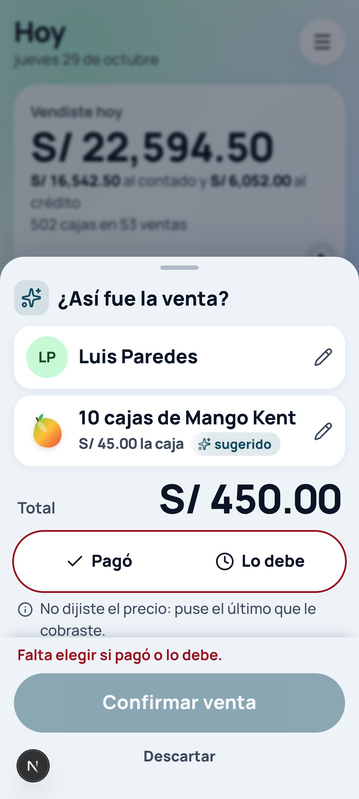
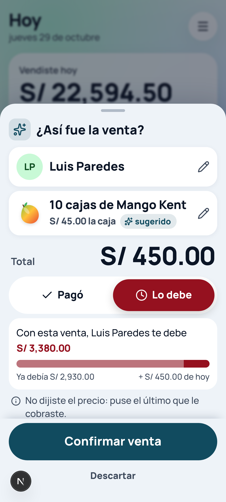
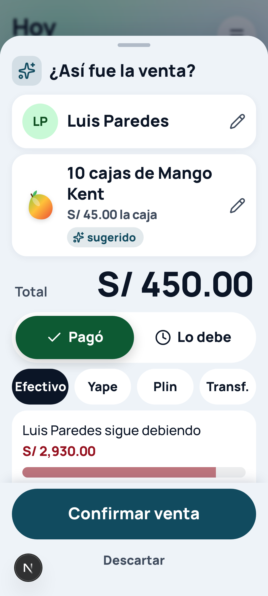
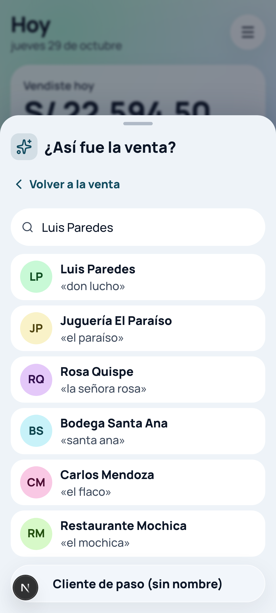

# /formidable · Hoja de venta por voz · 2026-10-29

**Para quién:** el dueño, de pie en el puesto, con el celular en una mano.
**Para qué** (CLAUDE.md, «La voz»): ver en grande lo que se entendió, corregir de un toque y confirmar con un solo botón. Nunca se asume contado.
**Qué se midió:**
- la hoja en cinco estados: falta la condición, Lo debe, Pagó, editor de fruta y editor de cliente;
- el aviso «Deshacer»;
- a 412 × 915, 360 × 800 y 1280 × 800, con la voz simulada y un comando real en la base.

## 1. Medido

| Qué | 412 | 360 | 1280 |
|---|---|---|---|
| Desborde horizontal | no | no | no |
| Confirmar en el tercio de abajo y visible | sí (771–839) | sí (656–724) | sí |
| Controles < 48 px | ninguno | «Volver a la venta» y el campo de precio miden 48 justo | igual |
| Textos < 4.5:1 | ninguno* | ninguno* | ninguno* |
| Textos entre 4.5 y 7:1 | ninguno | ninguno | ninguno |
| Textos < 17 px | «sugerido» (15, pieza `Insignia`) y la leyenda del medidor (15) | igual | igual |
| La hoja necesita scroll | no | sí, con Lo debe o Pagó | no |

\* El script marcó «Pagó / Lo debe» con 1:1 porque la píldora de color es hermana del texto, no su ancestro. Calculado aparte: blanco sobre `--exito` da 8.31:1 y blanco sobre `--deuda`, 8.83:1.

- **Confirmar:** responde en 120–390 ms en la base local.
- **JavaScript de «Hoy» con sesión:** 176.9 KB brotli, con tope de 180.
- **e2e de la hoja:** 22 en verde.

## 2. Prueba ciega (Observado)

Un agente sin contexto recibió la captura a 412 (estado «falta la condición») y tres tareas: dejarlo como deuda, cambiar el precio a 47 y cambiar el cliente a Rosa.
- **Completó las tres en 2 toques cada una.**
- **Entendió que la venta todavía no estaba guardada** («¿Así fue la venta?» y «Confirmar venta»).
- **Dudas:**
  - El óvalo de borde rojo de «Pagó / Lo debe» le pareció **un solo campo, no dos botones**.
  - **No sabía si «Luis Paredes» era «don Lucho»:** la tarjeta muestra el nombre del cuaderno, no lo que él dijo.
  - «S/ 45.00 la caja» y «sugerido» no parecen tocables. Fue al lápiz.
  - La nota «No dijiste el precio…» **queda cortada** por el pie con Confirmar.
  - No supo si «Vendiste hoy», borroso detrás, ya incluía esta venta.

## 3. Notas

| Ley | Nota | Por qué |
|---|---|---|
| 1 Sin manual | 7 | Lo completa, pero duda en Pagó / Lo debe y en quién es «Luis Paredes». |
| 2 Una pregunta | 8 | Un protagonista (la venta) y un Confirmar; el medidor compite un poco. |
| 3 Simplicidad profunda | 8 | «Con esta venta, Luis Paredes te debe S/ 3,380.00» es un veredicto. |
| 4 Lenguaje de puesto | 9 | «Lo debe», «Falta elegir si pagó o lo debe», «No guardé esa venta». |
| 5 Contenido primero | 9 | Cliente, fruta y total pesan más que los marcos. |
| 6 Lo difícil a un toque | 8 | Corregir está a un toque, aunque el lápiz es la única pista. |
| 7 Perdonar | 9 | Descartar se deshace durante 5 s; Confirmar es lo único irreversible. |
| 8 Quitar | 7 | Con «Pagó», el medidor ocupa una tarjeta para decir «Hoy no suma». |
| 9 De punta a punta | 7 | La nota del intérprete queda tapada a 412 y 360; los vacíos y errores sí están. |

| Regla | Nota | Por qué |
|---|---|---|
| C1 Pulgar | 10 | Confirmar queda fijo abajo (medido). |
| C2 Tamaño | 9 | Todo mide 48 o más, aunque dos controles quedan justo en 48. |
| C3 Sol | 8 | Todo tiene 7:1 o más; la insignia y la leyenda van a 15 px. |
| C4 Bordes | 9 | Sin desborde; con el teclado abierto no se midió. |
| C5 Hojas | 10 | Una sola `<Hoja>`. |
| C6 Navegación | 10 | No cambia. |
| C7 Señal | 9 | Texto e icono en Pagó y Lo debe; vibración y sonido al guardar. |
| C8 Velocidad | 8 | Cabe en el presupuesto con 3 KB de margen; el INP no se midió en un Android real. |

- **Oficio visual: 8.5.** Grilla y espacios limpios, una familia y cifras tabulares, la maqueta Aurora respetada, movimiento con `prefers-reduced-motion`.
- **Nota total: 8.4.**

## 4. Los 3 cambios de mayor impacto (esperan OK)

1. **«Pagó / Lo debe» se ve como dos botones cuando falta elegir** (ley 1, C7).
   - Antes: un óvalo con borde rojo y dos palabras adentro.
   - Después: la pregunta escrita arriba («¿Pagó o lo debe?») y dos botones separados, cada uno con su contorno. Al elegir, vuelve la píldora que se desliza.
   - Se verifica repitiendo la prueba ciega, que no debe dudar, más el e2e.
2. **Debajo del cliente se ve lo que dijiste** (ley 1, ley 3).
   - Antes: «Luis Paredes» solo.
   - Después: «Luis Paredes» y abajo «dijiste: don lucho». El dato ya viene en la tarjeta (`cliente.dicho`), no hay que consultar nada más.
   - Se verifica con la prueba ciega: debe saber que es don Lucho.
3. **Con «Pagó», la deuda vieja va en una línea, y la nota del intérprete sube** (ley 8, ley 9, C3).
   - Antes: con «Pagó» queda una tarjeta con barra y «Hoy no suma», y la nota queda tapada por el pie.
   - Después:
     - con «Pagó», una línea: «De antes, Luis Paredes te debe S/ 2,930.00» (solo si debe algo);
     - con «Lo debe», el medidor queda como está, con la leyenda a 17 px;
     - las notas del intérprete pasan justo debajo de las frutas, antes del total.
   - Se verifica midiendo a 360: con «Pagó», sin scroll y sin la nota tapada.

- **Lo que sobra (ley 8):** con «Pagó», la barra del medidor. Va en el cambio 3.
- **Lo que nadie pidió y más importa:** probarlo con la voz del dueño, en su celular y en 4G. La latencia real de soltar el botón a ver la tarjeta todavía no se midió.

**Lista aparte, sin ejecutar:**
- «sugerido» a 15 px es la pieza `Insignia` de toda la app: subirla a 17 es una decisión de identidad, no de esta hoja.
- En el editor de cliente, marcar al cliente actual con un visto.
- A 1280, una línea fina queda bajo «Descartar», por el pie fijo.
- Un borde de 2 px alrededor del campo de precio, para que tocar el contorno también enfoque.

El `/chaos` del mismo día (`docs/chaos/voz-venta-2026-10-29.md`) encontró además seis defectos de guardado. Van aparte de estos 3 cambios.

## Capturas (antes)

| Falta la condición (412) | Lo debe (412) | Pagó (360) | Editor de cliente (412) |
|---|---|---|---|
|  |  |  |  |
